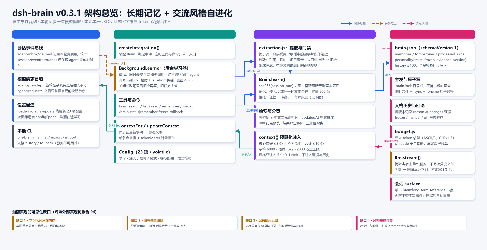
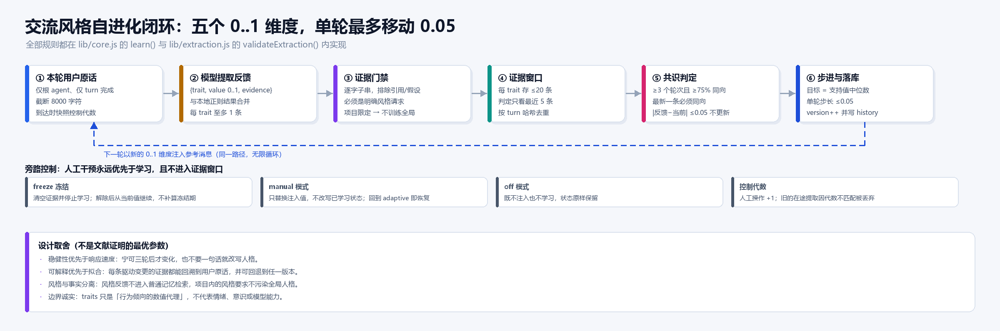
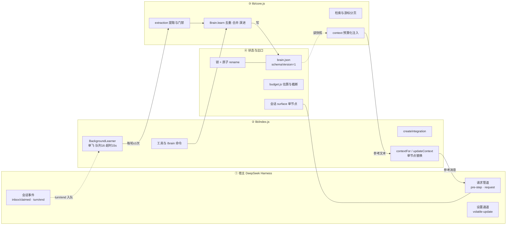

# DSH Brain 的记忆与性格自进化机制拆解 + 外部实现对照

调研与代码阅读日期：2026-10-28。对象：本仓库 `@yulianjie/dsh-brain` v0.3.1。

> **本文的证据分两类，读之前请先分清来源**：
>
> 1. §1–§9 的外部对照**不是**联网检索结果，而是本地安装的 Claude Code / Codex 的配置文件、更新日志与 SQLite 表结构（复核方式见 §9 附录 A），加上公开资料，置信度逐条标注。zcode 未验证。
> 2. §10–§12 依据联网检索的摘要与官方文档片段，未能抓取全文；凡二手推断已单独标注。

---

## 0. 一句话结论

dsh-brain 现在的机制是「**证据约束 + 有界步进 + 全量可回滚**」的保守派设计：记忆走 `global/workspace` 两域 JSON 存储，性格走 `5 维 0..1 + 最近 5 条证据共识 + 单轮 ≤0.05` 的限速器。它在**可控性、可解释性、防漂移**上明显强于 Claude Code / Codex 的现状；但在**后台可靠性（重启即丢）、容量演进（只增不并）、检索质量（无使用反馈）、表达效率（把性格作为裸 JSON 注入）**四件事上落后，这四项也正是最值得借鉴的地方。

---

## 1. 当前实现：数据模型与四个作用域

状态是**单一 JSON**（`$DSH_HOME/brain/brain.json`，默认 `~/.dsh/brain`），`schemaVersion=1`，写入前必须通过 `validateState()` 的白名单全量校验（`lib/core.js:38-85`）——字段多一个、时间戳非法、疑似凭据，都会直接报错而**不覆盖**旧文件。

| 字段 | 内容 | 约束 |
| --- | --- | --- |
| `memories[]` | `id/text/kind/scope/workspace/source/confidence/key/createdAt/updatedAt/personalityTraits` | 单条 ≤2000 字符，全局 ≤`maxMemories`(500) |
| `tombstones[]` | 已删除记录的 sha256 身份 | 阻断自动提取让已删事实复活 |
| `processedTurns[]` | `sha256(sessionId, turnId)` | 轮级幂等，防重放 |
| `personality` | `traits{five}/frozen/evidence{}/version/controlGeneration` | 证据每维 ≤20，窗口判定用最近 5 |
| `history[]` | 每次人格变更的 `reason/traits/changes` | ≤100 条，支持 `rollback(version)` |

作用域只有两维，**没有第三维**：

- `global`：同一 `DSH_HOME` 内跨会话、跨工作区共享（个人偏好）；
- `workspace`：绑定一个绝对路径（项目事实），`scopePath()` 在 Windows 上会 `toLowerCase()` 后再比较（`core.js:16`）；
- 另有两个**非存储**作用域：`session`（注入载体，见 §2.3）与 `runtime`（`Config` 热更新，不落盘到 brain.json）。

---

## 2. 记忆的生命周期

### 2.1 三条写入路径，两道门禁

```text
① 自动提取   turn/end → BackgroundLearner → llm.stream → validateExtraction → Brain.learn
② 模型工具   brain_remember(text, scope, kind) → Brain.remember(confidence=0.9)
③ 人工入口   /brain remember … / CLI import / 原生设置
```

①是唯一「模型参与」的路径，也是唯一带证据门禁的路径。门禁不在提示词里，而在代码里（`lib/extraction.js:53-80`）：

- `evidence` 必须是本轮 `userText` 的**逐字子串**（`userText.includes(evidence)`），模型不能改写、概括或转述；
- `eligibleEvidence()` 会拒绝：代码块内的片段、含引号/第三人称转述的句子、"这次/暂时/仅此一次"的临时要求、"不要记住"的显式拒绝；
- `containsCredential()` 用一套正则拦私钥、`sk-/ghp_/AKIA/AIza/JWT/Bearer`、`password: xxx` 与 URL 内嵌口令；
- `confidence < 0.7` 直接丢弃；`scope` 由句子里的项目线索词**重新判定**（`memoryScope()`），模型说的 scope 只是候选——避免模型把"本项目"的偏好扩大成全局人格。

也就是说：**模型只负责"挑"，不负责"写"**。写进去的文本就是用户原话，而不是模型的总结。这是本项目最值得保留的设计。

### 2.2 去重、合并与遗忘

- 身份 = `sha256(scope, workspace, key || normalized(text))`；同一 `key` 视为同一语义槽位，触发**更新**而不是新增（`core.js:185, 205-208`）。
- 删除写墓碑（`tombstones`），自动路径命中墓碑就返回 `null`，人工路径则可以显式复活并清墓碑（`core.js:199, 216`）。
- `forget()` 会**连带清洗人格证据**：任何包含该记忆文本的 evidence 与 history 变更证据都会被移除（`core.js:297-299`），避免"删了事实但风格还留着它的影响"。
- 容量满了以后：自动写入静默丢弃，人工写入抛错（`core.js:210-214`）——设计上不替你删数据。

### 2.3 注入：一次请求只有一条参考消息

注入不是往 system prompt 里拼字符串，而是**接管一个用户可见节点**：

1. 首个请求由 `agent/pre-step` 在宿主受保护的系统头**之后**追加一条 `brain:long-term-reference`（`index.js:184-189`；v0.3.1 修的就是"别跑到系统头前面"）；
2. 后续请求在 `agent/request` 里用 `surfaceOp: replace` 原地替换同一个节点（`lib/context.js:14-57`），内容没变就不写事件；
3. 替换前补一条 `compaction/prune` 计量事件，让宿主的 token 统计跟着缩，而不是继续按旧消息计费；
4. 历史里若残留旧的 `runtime-context` 共享快照，只摘掉 Brain 那一节，其它插件的内容原样保留（`context.js:41-49`）。

预算（`core.js:404-443`）是**四层叠加**：条数 ≤10、字符 ≤6000、估算 token ≤2000、单条预览 ≤400 码点；核心偏好额外拿 ≤1/3 条数与 ≤1/3 token 的子预算，保证"无关问题也带一点语言偏好"，但不会把整库灌进去。

排序（`core.js:225-232`）是**纯词法**：整串命中 +10，每个 token 命中 +1，中文按字符二元组切（`terms()`），平局用 `updatedAt` 再按 `id`。**没有向量、没有 embedding、没有使用频次**——这是刻意的（`docs/MEMORY-CONTEXT-REVIEW.zh-CN.md` §"没有引入向量数据库"）。

---

## 3. 性格（交流风格）的自进化

> 术语对齐：本项目的"性格"= 持久的语言行为偏好，五个维度 `warmth/verbosity/humor/proactivity/formality`，取 `[0,1]`，默认 0.5。它**不是**人格模拟，也不声称模型有情绪。

### 3.1 一次演进的完整判定链（`core.js:359-376`）

```
feedback{trait, value, evidence}
  → 证据入窗（每维 ≤20，判定只看最近 5）
  → 支持集 = 窗口中 |value − 当前值| > 0.05 且方向一致者
  → 门槛：supporting ≥ max(3, ceil(recent×0.75))     ← 5 条窗口时等于「≥4 且 ≥80%」
  → 死区：|feedback.value − 当前值| ≤ 0.05 → 不动
  → 目标 = 支持集的中位数
  → 步长 = clamp(target − 当前值, ±0.05)，保留 4 位小数
  → version++，写 history(reason='feedback', changes[])
```

三个容易忽略但很关键的细节：

1. **"最新一条必须同向"隐含在支持集定义里**：最新反馈若反向，它的 `Math.sign` 与 `direction` 不符，不计入支持集；而支持集要凑够 3~4 条，通常就凑不够了 → 不更新。
2. **`supporting` 是相对"当前值"过滤的**：随着 traits 移动，早期证据会逐渐掉出支持集。这让"连续同向"成为必要条件，代价是**收敛慢**。
3. **人工操作一律 +1 `controlGeneration`**（`core.js:317, 323, 329`），`learn()` 带着消息到达时快照的代数进入，代数不匹配就整段丢弃 → 冻结/重置前发出的在途提取不会"回来复仇"。
4. **风格原句不回灌**：自动提取出的风格偏好记忆会带 `personalityTraits` 标记，`context()` 在检索前把这些记录整体排除（`core.js:422`）。所以"以后回答简短点"**不会**以原句形式立刻进入上下文，只能通过上面的限速器生效——否则一句话就能绕过全部门槛，等于把限速器架空。

### 3.2 三种模式与旁路的正交关系

| 模式 | 注入 | 学习 | 状态 |
| --- | --- | --- | --- |
| `adaptive` | 学到的 `traits` | 开启（还受 `autoLearn`、`personalityLearningEnabled`、`frozen` 三重与门） | 持续演进 |
| `manual` | `manualTraits` 五个滑杆 | 关闭 | 已学状态原样保留，切回即恢复 |
| `off` | 不注入 | 关闭 | 状态保留 |

`frozen` 与模式**正交**：冻结时清空证据、不积攒"解冻后突然生效"的漂移，这也是它和 `manual` 的区别。

### 3.3 架构图





两张图由 `docs/assets/render-architecture.py` 生成（Pillow，无外部依赖；改文案重跑即可，布局按文本测量自动撑高，脚本会打印溢出告警）。可编辑的等价 Mermaid 版本：



---

## 4. 外部实现对照（可在本地复核）

### 4.1 Claude Code —— 自动记忆 + 输出风格

**证据来源**：`~/.claude/projects/<slug>/memory/`、`~/.claude/cache/changelog.md`（本地缓存的更新日志）。

**记忆结构**是"索引 + 主题文件"，不是单一数据库：

```
~/.claude/projects/<project-slug>/memory/
├── MEMORY.md        ← 索引：一行一条，「标题」+ 文件链接 + 一句描述
└── <topic>.md       ← 主题文件：frontmatter(name/description/metadata.type/时间戳) + 正文
```

从 changelog 可以还原出硬约束（版本号在括号内为日志出现位置，非精确版本）：

| 机制 | 事实 |
| --- | --- |
| 索引上限 | `MEMORY.md` 同时按 **25 KB 和 200 行**截断（#2794） |
| 超限行为 | 写入导致索引超限会**显式报错**，不做静默截断（#314）；接近上限时提醒 agent 自己压缩索引（#755） |
| 索引计量 | 只统计加载内容，排除 frontmatter 与 HTML 注释（#273） |
| 存储可配置 | `autoMemoryDirectory` 可改自动记忆目录（#3019） |
| 新鲜度 | 记忆文件带最后修改时间戳，供模型判断"新 vs 旧"（#154, #2999） |
| 共享范围 | 同一 git 仓库的多个 worktree 共享项目配置与自动记忆（#3302） |
| 团队存储 | 远程会话中支持挂载团队记忆库 `CLAUDE_MEMORY_STORES`（#937） |
| 关闭方式 | `--bare` 模式下自动记忆**完全禁用**（#2811） |
| 性格 | 走 **output styles**（自然语言 markdown，带 `keep-coding-instructions` frontmatter，可被插件分发）；已明确为**在会话开始时固定**以提升 prompt 缓存命中（#3062）；嵌套 `.claude/` 下"最近者胜"（#845） |

**值得注意的两点**：① 它把"记忆"交给模型自己用读写文件的方式维护，索引是人可读的 markdown，不是隐藏状态；② 它为了 prompt 缓存，主动把"性格"从"每轮可变"改成"会话级固定"——这和本插件"每轮重算注入文本"的做法正好相反。

**置信度**：高（本地文件 + 官方更新日志原文）。

### 4.2 Codex —— 两阶段整合 + 租约式后台队列

**证据来源**：`~/.codex/config.toml`、`~/.codex/memories_v2_1.sqlite`、`~/.codex/state_5.sqlite`、`~/.codex/.personality_migration`（Codex Desktop v0.147.0）。

配置里记忆被拆成**生产**与**消费**两个独立开关，外加一个总特性位：

```toml
[features]
memories = true

[memories]
generate_memories = true   # 后台从历史会话"生成"记忆
use_memories    = true     # 请求时"使用"记忆
```

`memories_v2_1.sqlite` 的表结构直接暴露了它的流水线：

| 表 | 关键列 | 含义 |
| --- | --- | --- |
| `jobs` | `kind, job_key, status, worker_id, ownership_token, lease_until, retry_at, retry_remaining, input_watermark, last_success_watermark` | **带租约、带重试、带水位**的持久化任务队列 |
| `stage1_outputs` | `thread_id, source_updated_at, raw_memory, rollout_summary, rollout_slug, usage_count, last_usage, selected_for_phase2, selected_for_phase2_source_updated_at` | 每个会话（thread）一份阶段一产物：原始记忆 + 会话摘要 |
| `consolidation_progress` | `max_thread_count` | 阶段二整合的**水位线**：已整合到第几个 thread |
| `_sqlx_migrations` | version/description | 带版本号的 schema 迁移 |

由此可以还原出它的架构：**阶段一**逐会话生成 `raw_memory` + `rollout_summary`，**阶段二**按 `max_thread_count` 水位把被选中（`selected_for_phase2`）的会话产物跨会话整合成长期记忆；`usage_count`/`last_usage` 记录"这条记忆被用过几次、最近一次什么时候"，显然用于排序或淘汰。

另外两个信号：

- `threads` 表有 `memory_mode` 列 → 记忆是**会话级可关**的；
- 家目录有 `.personality_migration`，内容 `v1` → 性格是**带版本迁移的持久状态**，不是每轮临时算出来的。（具体预设名无从验证，**置信度：中**）

项目指令仍走 `AGENTS.md` 文件约定，长期记忆则放在 SQLite 里，两者彻底分离。

**置信度**：表结构与配置为高；"阶段二具体用什么模型/提示词"为推测。

### 4.3 zcode —— 无法下结论

调研时没有可核实的 zcode 安装或官方资料，因此本文**不给出** zcode 的机制描述：凭印象把某个 CLI 的目录结构写成事实，比留空更糟。补齐需要它的配置目录或官方文档。

---

## 5. 对照矩阵

| 维度 | dsh-brain 0.3.1 | Claude Code | Codex (v0.147) | zcode |
| --- | --- | --- | --- | --- |
| 记忆载体 | 单一 `brain.json` | `memory/MEMORY.md` + 主题 md 文件 | SQLite（`memories_v2_1`） | 未验证 |
| 谁写 | 模型**只能选**，代码写原文 | 模型自己读写文件 | 后台 job 生成 | 未验证 |
| 写入时机 | 根会话 `turn/end`，异步 | 工作过程中随时 | 后台 job + 水位增量 | 未验证 |
| 注入 | 单节点替换，≤10 条/6000 字符/2000 token | 索引常驻 + 主题按需读取 | 未在本地取证 | 未验证 |
| 容量与淘汰 | 500 条硬顶，满了静默丢弃 | 索引 25 KB / 200 行双限 | 水位 + 使用计数 | 未验证 |
| 去重/冲突 | `key` 合并 + 文本归一化 + 墓碑 | 依赖模型自觉 | 阶段二整合 | 未验证 |
| 遗忘 | 墓碑 + 连带清证据，可导入合并 | 删文件 | 未取证 | 未验证 |
| 性格表达 | 5 维数值 + 一行维度说明 | 自然语言 output style | 持久设置（迁移 v1） | 未验证 |
| 性格学习 | 显式反馈 + 证据共识 + 限速 | 无（需用户手写 style） | 未取证（推测无自动学习） | 未验证 |
| 后台可靠性 | **内存队列，重启即丢** | 无后台队列 | **持久化 + 租约 + 重试 + 水位** | 未验证 |
| 跨设备/团队 | 无（本地） | 团队记忆库 + worktree 共享 | 账号级状态库 | 未验证 |

一句话读法：**dsh-brain 赢在"写入门禁"和"可回滚"，输在"后台管道"和"表达形式"。**

---

## 6. 可以借鉴什么（按性价比排序）

### P0-1　把性格从"裸 JSON"改成"行为描述"　★性价比最高

- **现状**：注入的是 `{"mode":"adaptive","traits":{"warmth":0.62,…}}` 加一句维度释义（`core.js:418`）。模型要自己做"0.62 → 多暖"的映射，映射不稳定，且数字对模型是弱信号。
- **他山之石**：Claude 的 output style 是纯自然语言 markdown；Letta 的 persona 是常驻文本块。这两家都不把裸数值向量直接喂给模型。
- **落点**：新增纯函数 `styleBrief(traits)`（`lib/extraction.js` 或新的 `lib/style.js`），输出 3~5 句行为约定，例如「回答偏简短，先给结论再补一句理由；语气中性偏暖，不用玩笑；不主动扩展未被问到的方向」。JSON 仍保留在 `/brain personality` 与设置页作为可解释状态，但**不进注入文本**。
- **成本**：低（纯函数 + 快照测试，1 天）。**风险**：描述与数值漂移 → 同一函数生成、覆盖 0/0.5/1 边界快照即可。
- **验证**：固定 traits，对比"裸 JSON"与"行为描述"两版在 20 轮合成对话里的风格遵循率（人工评分或成对比较）。

### P0-2　风格在会话内固定，跨会话再生效

- **现状**：`context()` 每轮读最新 `traits`，性格一变，注入文本就变 → 前缀缓存失效（项目文档已承认这个代价），且用户会看到"同一会话里语气漂移"。
- **他山之石**：Claude 明确把 output style **固定在会话开始**，理由就是 prompt caching。
- **落点**：镜像现有的 `personalityGeneration` 机制——会话首个请求快照一份 `styleEpoch`（存 `WeakMap` 或 session header），本会话内注入该快照；`/brain personality` 显示"当前会话使用 v3，最新已到 v4，下个会话生效"。保留一个 `applyImmediately` 开关给想立刻看到变化的用户。
- **成本**：低（半天，机制已有）。**风险**：用户当轮说"以后简短点"看不到即时效果 → 用文案明确"下个会话生效"。
- **验证**：同一会话内连续 10 轮，注入文本哈希不变；新会话读到新值；`/brain personality` 前后一致。

### P0-3　把学习队列落盘（outbox），带重试与死信

- **现状**：`BackgroundLearner.queue` 是内存数组（`index.js:37, 48`），进程退出即丢；`drain()` 失败只 `warn` 一次（`index.js:96-101`），该轮永久丢失；无重试、无 lease、无水位。
- **他山之石**：Codex 的 `jobs` 表（status / lease_until / retry_remaining / last_error / input_watermark）。
- **落点**：`$DSH_HOME/brain/outbox.jsonl`（append-only，一行一个 `{sessionId,turnId,workspace,userText,personalityGeneration,at}`）；`enqueue` 先 fsync 落盘再入内存队列；成功后追加 `{turn, done:true}` 或直接依赖 `processedTurns`；`init()` 时 `replay()` 把未完成项重新入队；失败用指数退避重试 ≤3 次，超限写 `dead-letter` 并在 `/brain status` 暴露。
- **成本**：中（~150 行 + 测试）。**风险**：重复执行 → 已被 `processedTurns` 幂等兜住（`core.js:347`）。**额外收益**：桌面端"关窗口就丢学习"这个真实抱怨会消失。
- **验证**：`taskkill /F` 后重启能补学；同一 turn 投递 3 次只产生 1 条记忆；失败 3 次后状态可见。

### P1-4　注入改成"索引行"而非 400 字预览

- **现状**：每条注入 ≤400 码点，10 条就吃满 4000 字符预算的大部分；记忆一多，条数被预算挤到个位数。
- **他山之石**：Claude 的 `MEMORY.md` 一行一条（标题 + 一句描述），25 KB 能装几百条；全文靠按需读取。
- **落点**：`context()` 增加 `contextStyle: 'preview' | 'index'`（默认 index）。索引行形如 `- [preference] 称呼：用户要求称呼为船长 (id=13fa94e2)`，约 60 字；同样预算下条数可翻 5 倍，细节交给 `brain_read`（已有游标分页）。
- **成本**：低。**风险**：模型可能"看索引就编" → 提示词里明确"索引不含事实细节，需要时用 brain_read"。

### P1-5　加"使用反馈"与时间衰减

- **现状**：`_rank()` 只用词法分 + `updatedAt`（`core.js:225-232`），从不记录"哪条记忆被注入/被读过"。
- **他山之石**：Codex 的 `usage_count` / `last_usage`；Claude 的 modified 时间戳用于判断新鲜度。
- **落点**：记录加 `hits` 与 `lastHitAt`。**注意这里有个真实的设计张力**：`context()` 是同步只读快照，不能在读路径上写盘。做法是内存累积 `pendingHits`，在下一次写事务里合并落盘（`learn`/`remember`/`forget` 任一都会触发），或每 N 次单独提交。排序分改成 `词法分 + 0.5·log(1+hits) − 0.02·ageDays`。
- **成本**：低-中。**风险**：读路径写状态会破坏并发模型 → 必须走"延迟合并"，不能直接 `_transaction`。

### P1-6　加一个整合（consolidation）阶段

- **现状**：只有逐轮追加，没有合并/提炼；到 500 条后自动写入**静默丢弃**（`core.js:210-214`），库不再演进。
- **他山之石**：Codex 的 `stage1_outputs` → `selected_for_phase2` → `consolidation_progress.max_thread_count` 两阶段 + 水位。
- **落点**：新增 `consolidate({budget})`：按 `key`/主题聚类 → 一次模型调用生成合并摘要 → 新记录带 `supersedes: [id…]`，旧记录保留但降权（软合并，不物理删）；`consolidationProgress` 记录已处理的最大 `revision`。可由主进程空闲时触发，或 `/brain consolidate`。
- **成本**：中-高（要改 `validateState` 白名单、迁移到 `schemaVersion=2`、写迁移测试）。**风险**：合并丢细节、模型胡编 → 只允许"多对一摘要 + 保留原文"，且摘要只用于注入排序，不替代原文。

### P2-7　会话级/临时开关

Codex 的 `threads.memory_mode` 值得抄：`/brain off` 关掉本会话的记忆读写（隐私场景），比全局开关安全得多。落点：`/brain` 命令集加 `off|on`，实现是在 `turns` 状态里加 `disabled` 标记并让 `contextFor()` 返回空。

### P2-8　可观测性

`/brain status` 现在有 `counters`（completed/dropped/extractionFailures/…）但没有"为什么没生效"。建议加：outbox 深度、最近 3 条失败原因、提取成功率、**本轮注入的条数与字节数**、以及 `personality.backlog`——"已收到 N 条风格反馈、还差 M 条同向才会生效"。缺少这类可见性时，风格反馈长期不生效，用户也看不出原因。

### P2-9　跨设备/团队共享

Claude 的 `CLAUDE_MEMORY_STORES` 与 worktree 共享值得作为**长期项**记录，但超出"本地插件"的边界。短期可先做导出/导入的合并语义（`importData()` 已有墓碑合并逻辑，缺冲突解决策略）。

---

## 7. 不建议照搬

| 不建议 | 理由 |
| --- | --- |
| 向量库 / embedding 检索 | 500 条、单条 2 KB 的规模，关键词 + 中文二元组足够；引入后会多出模型、网络、隐私与部署四个面，还会破坏"零依赖、纯本地"这条产品线。 |
| 让模型自己写记忆文件（Claude 的 auto-memory 模式） | 与本项目"证据必须是用户原话"的核心约束直接冲突，会把"模型自说自话"重新引入。 |
| 多层目录递归加载（CLAUDE.md 的层级 + 子目录按需） | `global/workspace` 二维已经够用；加层级会让"两个文件冲突时谁赢"变成新的 bug 面。 |
| 把 Claude 的 25 KB / 200 行硬限直接搬过来 | 单位不同：它的索引是文件，我们的注入是 token 预算。要抄的是"索引/详情分离"，不是具体数字。 |

---

## 8. 建议的落地顺序

| 批次 | 内容 | 工期量级 | 主要收益 |
| --- | --- | --- | --- |
| v0.4 | P0-1 行为描述 + P0-2 会话内固定 + P2-8 观测性 | 2~3 天 | 风格**可感知**地变好，且不再抖 |
| v0.4 | P2-7 会话级开关 | 半天 | 隐私场景可用 |
| v0.5 | P0-3 outbox 持久化 | 2 天 | 学习不再因关窗口丢失 |
| v0.5 | P1-4 索引化注入 + P1-5 使用反馈 | 2~3 天 | 同预算下召回量级提升 |
| v0.6 | P1-6 整合阶段（含 schemaVersion=2 迁移） | 4~5 天 | 库能长期演进而不是卡死 |

---

## 9. 附录 A：本文证据的复核方式

在装有对应工具的机器上可以这样复核（只读，不涉及任何凭据内容）：

```powershell
# Claude Code 的自动记忆结构
Get-ChildItem "$HOME\.claude\projects\*\memory" -Recurse
Get-Content "$HOME\.claude\cache\changelog.md" | Select-String 'MEMORY.md|autoMemoryDirectory|CLAUDE_MEMORY_STORES|output style'

# Codex 的记忆开关与 schema
Select-String "$HOME\.codex\config.toml" -Pattern '^\[memories\]|generate_memories|use_memories|^\[features\]'
# memories_v2_1.sqlite: jobs / stage1_outputs / consolidation_progress
# state_5.sqlite:      threads.memory_mode
Get-Content "$HOME\.codex\.personality_migration"

# 本项目状态（仅统计）
Get-Content "$HOME\.dsh\brain\brain.json" | ConvertFrom-Json | Select-Object revision,
  @{n='memories';e={$_.memories.Count}}, @{n='turns';e={$_.processedTurns.Count}}
```

未能完成的验证：zcode（缺少可核实的资料），以及三家产品真实"风格遵循率"的对比（需要真实模型的多轮 A/B 测试）。

---

## 10. 2026-10 联网补充：业界当前在用什么方法

> 本节写于 2026-10-28，来源为联网检索；未能抓取全文，因此结论基于检索摘要与官方文档片段，凡二手推断已单独标注。

### 10.1 记忆：四条主线已经收敛

| 主线 | 代表实现 | 核心做法 | 对本项目的含义 |
| --- | --- | --- | --- |
| **记忆即文件** | [Claude Code auto memory](https://code.claude.com/docs/zh-CN/memory)、[soul-file 类方案](https://github.com/kody-w/rappterbook/discussions/4287)、[中文三层记忆技能](https://github.com/syc-dspyy/agent-memory-skill) | `MEMORY.md` 做索引，**每次会话开始只加载前 200 行或 25 KB（先到为准）**；每个记忆一个主题文件，细节按需读 | 我们 v0.3.1 的"索引/详情分离"方向已经对了，但注入还是 400 字预览，没有真正的"索引行" |
| **睡眠期整合（dream）** | [Anthropic Dreams](https://platform.claude.com/docs/en/managed-agents/dreams)（beta `dreaming-2026-04-21`）、[Letta sleep-time compute](https://zenodo.org/records/20780690) | 读"现有记忆库 + 若干历史会话"，产出**一份重新组织的新库**：重复合并、过期/矛盾的用最新值替换、新洞见浮出 | 这正是本项目缺的那一环；而且它把"允许模型概括"关在离线环节里，不与写入门禁冲突 |
| **选择优于提取** | [预注册研究（Zenodo 23005211）](https://zenodo.org/records/23005211) | 预算紧时，用类型化决策模型**从原始轮次里选**，效果**不劣于** LLM 提取入库；30 选 3 时 LoCoMo +17.4 分 | 说明"逐轮提取"不是唯一解，甚至不是最优解；但选择法需要长期保留原文，与 500 条上限的本地库不匹配（见 §11 取舍） |
| **生物式遗忘** | [Ebbinghaus 曲线类系统](https://zenodo.org/records/19435120)、[Agent Brain](https://zenodo.org/records/19673133) | 按遗忘曲线给记忆降权/淘汰；夜间衰减边、融合簇。Agent Brain 在 LongMemEval 报 71.7%，高于 Zep 63.8% / Mem0 49.0% | 我们的排序只有关键词 + `updatedAt`，缺"衰减"与"使用计数"两个维度 |

另有 MemOS 的 MemCube（统一明文/KV/参数三类记忆的生命周期管理）作为架构参考，但对 500 条规模的本地插件属于过度设计。

### 10.2 性格：从"人格描述"走向"可测的强度控制"

| 方法 | 来源 | 要点 |
| --- | --- | --- |
| **显式人格段落** | [OpenAI Prompt Personalities](https://developers.openai.com/cookbook/examples/gpt-5/prompt_personalities) | 在 system/developer prompt 层用**一段明确的自然语言**定义人格（Precise / Efficient / Fact-Based / Exploratory…），与任务指令、输出格式解耦；建议从最小集开始 |
| **具体优于泛化** | 同上 + 业内经验（二手） | "3–5 个形容词 + 1–2 句质感描述"有效；`be friendly and helpful` 这类泛化措辞是最差的一档，几乎不产生可测差异 |
| **强度可测可控** | [SAC, arXiv:2506.20993](https://huggingface.co/papers/2506.20993) | 用形容词做语义锚点，把强度拆成 **Frequency / Depth** 等五个强度因子来测量与诱导——这是"5 维 0..1"的学术对应物，且提供了**评测方法** |
| **人格漂移可测** | [Cross-Model Persona Fidelity](https://zenodo.org/records/18869743/files/cross-model-fidelity.pdf) | 把保真度拆成身份一致性、复杂任务下的漂移等维度分别打分 |

对本项目的直接结论：**"5 维 0..1"这个建模选择是对的（有 SAC 佐证），错的是把数值裸着交给模型。** 数值应该留在状态层做可解释与可回滚，进入上下文的必须是自然语言的行为段落。

---

## 11. 如果只改一个地方：加一次「dream」离线整合

前 10 节列了 9 条可借鉴项。但如果只允许动一处，我的选择是 **v0.4 加一个离线整合阶段（dream）**，理由是它一处解决三个结构性缺陷，而且不破坏现有任何一条安全约束。

### 11.1 它修的是什么

| 现状缺陷 | dream 如何消解 |
| --- | --- |
| 库只增不并，500 条后自动写入**静默丢弃**（`core.js:210-214`） | 整合把同义/重复记录合并成一条，腾出容量；丢弃变成"合并" |
| 注入的是 400 字预览，条数被预算挤到个位数 | 整合产出**索引行**（≤60 字/条），同预算条数提升 3~5 倍 |
| 风格只有裸数值，模型难以遵循 | 整合同时重写**一段自然语言风格段落**，由 traits 生成、但以行为描述呈现 |

### 11.2 为什么它比"选择法"更适合本项目

§10.1 的"选择优于提取"很诱人，但它要求**长期保留原始轮次**并在线做选择，直接冲掉本项目"单条 2000 字符、全库 500 条、单请求 2000 token"的全部边界。dream 是同一目标的**离线版本**：把"选择+概括"的成本挪到后台一次，在线只剩索引注入。这也是 Anthropic 和 Letta 共同的选择。

### 11.3 设计（可直接实现）

**触发**：`/brain dream` 手动；或启动时若 `dreamedAt` 超过 `dreamIntervalHours`（默认 24h）且 `memories` 有变化；或累计 N 次 `learn` 后。**同一时刻只允许一个 dream**（复用现有 `BackgroundLearner` 的单飞槽位）。

**输入**：`memories`（只取非 `personalityTraits` 标记的普通记忆）+ 已有 `key` 分组 + 每条 `id/updatedAt/hits`。不读会话原文——这与 Anthropic 的版本不同，但**更符合本项目"不读取其他 agent/历史来初始化"的边界**。

**输出**（强结构化，必须通过校验）：

```json
{ "groups": [{ "ids": ["a","b"], "title": "称呼偏好", "line": "用户要求称呼为船长", "drop": ["b"] }],
  "contradictions": [{ "ids": ["c","d"], "keep": "d", "reason": "时间更新" }],
  "style": { "brief": "回答偏简短：先给结论，再补一句理由。语气中性偏暖，不使用玩笑。", "basedOn": ["warmth","verbosity","formality"] } }
```

**校验规则**（`validateDream`，与 `validateExtraction` 同风格）：

1. 每个 `id` 必须存在于输入；`ids` 里至少一条的 `updatedAt` 是组内最新（防"用旧值覆盖新值"）；
2. `line` ≤60 码点，且**不得包含**输入中不存在的专有名词（用 `terms()` 做子集校验，允许删词、不允许造词）；
3. `drop` 必须写 `supersedes`，且原记录保留为"已合并"状态而非物理删除（`brain_read` 仍可取回原文）；
4. `style.brief` ≤600 字符，`basedOn` 必须是 `TRAITS` 子集；
5. 任一规则不过 → 整份 plan 丢弃，`dream` 记为失败，**不部分应用**（与配置校验的语义一致）。

**落点**：新增 `lib/dream.js`（纯函数：分组、校验、渲染）；`core.js` 加 `dream()` 事务、`index[]`/`dreamedAt`/`dreamRevision` 三个字段（`schemaVersion` 升到 2，`validateState` 白名单同步）；`context()` 在 `contextStyle='index'` 时优先用 `index[]`，回退到现有预览；`Config` 加 3 项（`dreamEnabled`、`dreamIntervalHours`、`dreamMaxTokens`）。

### 11.4 成功标准（可测，不靠感觉）

| 指标 | 现状 | 目标 |
| --- | --- | --- |
| 同预算（6000 字符）下的注入条数 | ≤10 条，多数为 400 字预览 | ≥25 条索引行 |
| 重复率（同 `key` 组内文本相似度 >0.8 的比例） | 未测，随使用上升 | dream 后 <5% |
| 召回率（合成集：把某条事实删掉再问） | 基线 | 不下降（dream 不得让原文不可达） |
| 风格遵循（SAC 的强度因子做人工/模型评分） | 裸 JSON，未测 | 同 traits 下评分高于裸 JSON 版本 |

### 11.5 与 §8 路线图的关系

dream 就是 §8 里的 P1-6 + P1-4 的合并实现，且顺带交付 P0-1 的"风格段落"。原计划的 v0.4（行为描述 + 会话内固定）仍然是 dream 的前置：**先把 `styleBrief()` 写出来，dream 直接复用它**，避免两套风格渲染逻辑。

---

## 12. 参考来源

- [Claude Code 记忆文档（中文）](https://code.claude.com/docs/zh-CN/memory)
- [Anthropic Dreams（Managed Agents）](https://platform.claude.com/docs/en/managed-agents/dreams)
- [OpenAI Cookbook: Prompt Personalities](https://developers.openai.com/cookbook/examples/gpt-5/prompt_personalities)
- [SAC: Measuring and Inducing Personality Traits with Dynamic Intensity Control (arXiv:2506.20993)](https://huggingface.co/papers/2506.20993)
- [When Does Selection Replace Extraction? 预注册研究](https://zenodo.org/records/23005211)
- [Agent Memory Research in 2026: Extended Survey](https://zenodo.org/records/20780690)
- [Agent Brain: LongMemEval 评测](https://zenodo.org/records/19673133)
- [SuperLocalMemory V3.3：Ebbinghaus 遗忘曲线](https://zenodo.org/records/19435120)
- [Cross-Model Persona Fidelity](https://zenodo.org/records/18869743/files/cross-model-fidelity.pdf)
- [soul file vs 向量库的取舍讨论](https://github.com/kody-w/rappterbook/discussions/4287)
